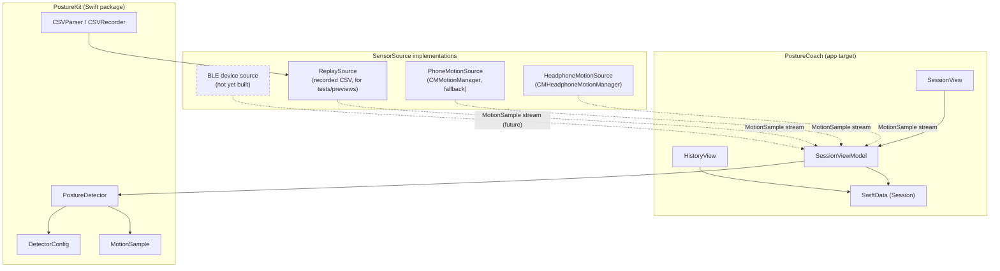

# PostureCoach

Detects slouching from AirPods head-motion data and nudges you to sit up straight.


## Architecture

All detection logic lives in the local Swift package **PostureKit**, which is
testable headlessly with `swift test` — no device required. The app target
is thin: SwiftUI views, SwiftData storage, and the CoreMotion sensor sources.
Everything talks to the detector through a single `SensorSource` protocol,
so a future BLE posture device (chest clip, smart cushion, etc.) can plug in
as another implementation without touching PostureCoach or the view layer.



All three implementations (and any future one) conform to the same
`SensorSource` protocol — `start() async -> AsyncStream<MotionSample>` and
`stop() async` — so `SessionViewModel` and `PostureDetector` never know or
care where the samples came from.

## Setup

```bash
# Run PostureKit's test suite (detector logic, CSV round-trips, replay timing)
cd PostureKit && swift test

# Build the app for the simulator
xcodebuild -scheme PostureCoach -destination 'generic/platform=iOS Simulator' build
```

Live motion detection requires a real iPhone with AirPods (or any headphones
with `CMHeadphoneMotionManager` support) — CoreMotion doesn't work in the
simulator, so that path is tested manually on-device. Everything else
(detector thresholds, calibration, debounce, nudging) is covered by
`swift test` against recorded CSV fixtures via `ReplaySource`.

## Results

`PostureKit`'s `DetectorEvaluationTests` replays every labeled fixture in
`Tests/PostureKitTests/Resources` through `PostureDetector` and reports
accuracy, false-nudge rate, and detection delay:

| Fixture | Accuracy | False nudges/hr | Avg detection delay |
|---|---|---|---|
| upright | 100.0% | 0.00 | – |
| slouching | 71.4% | 0.00 | 3.0s |
| glance-down | 100.0% | 0.00 | – |

Ground truth treats the `slouch` label as positive; `upright` and `glance`
(a dip too brief to count as a real slouch) are both negative. The
`slouching` fixture's 71.4% isn't a miss — it's the 3-second debounce window
(`minimumSlouchDuration`) by design: ground truth flips to "slouch" at
t=10.5s, but the detector doesn't confirm until t=13.5s, so those 6 samples
count against accuracy on purpose. Regenerate this table after any threshold
change with:

```bash
cd PostureKit && swift test --filter DetectorEvaluationTests
```

These fixtures are currently synthetic (hand-generated step functions), not
real AirPods recordings — see below.

## Design decisions and what went wrong

- **Timestamps, not timers.** Every piece of timing — calibration countdown,
  slouch debounce, nudge cooldown, session duration — is derived from each
  sample's own `timestamp`, never wall-clock `Date`/`Timer`. This means
  `ReplaySource` at a 10,000x speed multiplier produces byte-identical
  detector behavior to real-time playback, which is what makes the detector
  testable at all without a device.

- **PostureKit knows nothing about SwiftUI, SwiftData, or CoreMotion.** The
  app target is deliberately thin. `SessionViewModel` doesn't hold a
  `ModelContext` either — it emits a plain `SessionSummary` value, and
  `SessionView` (which legitimately has `@Environment(\.modelContext)`)
  decides what to persist. This kept the package testable headlessly and
  made the eval tool above possible without spinning up SwiftData or UIKit.

- **The fixtures are fake, and that's a known gap.** `upright.csv`,
  `slouching.csv`, and `glance-down.csv` are synthetic step functions I
  wrote by hand to pin down detector behavior (exact debounce timing, nudge
  cooldown, calibration averaging) before I had real data. They're good for
  regression-testing logic, but they can't validate the actual
  `slouchThresholdDegrees` default against a real head — a real slouch
  doesn't jump from 0° to -28.6° between two samples. Replacing these with
  real AirPods recordings (and re-running the eval table) is the next step
  before trusting the default thresholds.

- **Actors can't subclass `NSObject`.** `HeadphoneMotionSource` needs to be
  a `CMHeadphoneMotionManagerDelegate`, which requires `NSObject`. A Swift
  `actor` can't do that, so it's a `final class: NSObject, @unchecked
  Sendable` instead, with an `NSLock` guarding the one piece of mutable
  state (the stream continuation). `ReplaySource`, which has no such
  constraint, is a plain actor.

- **Nested git repos, caught before they became a real problem.** PostureKit
  and PostureCoach were briefly their own git repositories inside this one
  (no `.gitmodules`, no remotes), which meant most of the early work
  wasn't actually reachable from this repo's history. Caught and fixed by
  de-nesting both into the superproject before it caused a painful surprise
  later (e.g. a fresh clone missing half the code).

- **No BLE source yet.** The `SensorSource` protocol is designed so a
  dedicated posture-tracking device could be added as a fourth
  implementation without changing the detector or the view layer — see the
  dashed node in the architecture diagram above. Not built because I don't
  have hardware to test it against yet.
